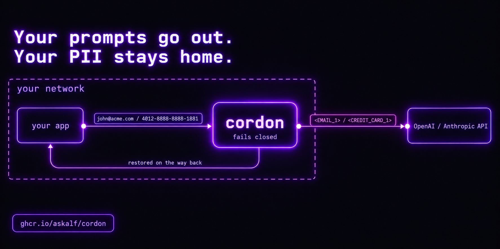

<p align="center"></p>

# cordon

[](https://github.com/askalf/cordon/actions/workflows/ci.yml)
[](https://github.com/askalf/cordon/actions/workflows/codeql.yml)
[](https://scorecard.dev/viewer/?uri=github.com/askalf/cordon)
[](LICENSE)

**A PII-redacting proxy for the OpenAI and Anthropic APIs.** Point your client at cordon instead of the provider. Emails, phone numbers, card numbers, SSNs, API keys and the rest are replaced with placeholders before the request leaves your network, and put back in the reply so your app never notices. One container, no database, no ML model, no client code changes beyond the base URL.

```
your app ──▶ cordon ──▶ api.openai.com / api.anthropic.com
              │
              ├─ model receives:    email <EMAIL_5285D1_1> re card <CREDIT_CARD_5285D1_1>
              └─ your app receives: email john@acme.com re card 4012-8888-8888-1881
```

## Quickstart

```bash
docker run -d --name cordon --init -p 127.0.0.1:8080:8080 \
  -v cordon-data:/app/data -e ADMIN_TOKEN=change-me \
  ghcr.io/askalf/cordon:v0.3.0
```

Then change one thing in your client: the base URL. Anthropic clients use `http://localhost:8080`, OpenAI clients use `http://localhost:8080/v1`. Your provider key goes through untouched; cordon never holds it. Every response says what it did: `X-Redacted: 2`, `X-Redacted-Types: EMAIL:1,CREDIT_CARD:1`.

A full captured round trip (both clients, the headers, what the provider was sent and the audit line) is in [docs/reference.md](docs/reference.md#a-full-round-trip).

## What it catches

Deterministic detection: regex plus checksum validators, no ML dependencies, fully auditable. Every entity with a check digit is validated before its span is accepted (Luhn for cards, ISO 7064 mod-97 for IBANs, ABA for routing numbers, SSN area/group rules), and overlapping matches resolve by precedence so a 16-digit card is not also clipped as a phone number.

| set | entities |
|---|---|
| `pii` | EMAIL, PHONE, SSN, IPV4, IPV6, MAC, STREET_ADDRESS |
| `phi` | MRN, DATE *(and SSN)* |
| `pci` | CREDIT_CARD, IBAN, US_ROUTING |
| `secrets` | OpenAI / Anthropic / AWS / GitHub / Google / Slack keys, JWTs, Bearer tokens, PEM private keys |

All four sets are on by default. Narrow them per tenant; a request can add sets with `X-Redact-Sets` but not drop them (see below).

## How it behaves

- **Fails closed.** If detection throws, the request is **blocked**, never forwarded with PII intact (`FAIL_MODE=closed`, the default). The test suite asserts the upstream is never called on that path.
- **Three modes**, per tenant or per request (`X-Redact-Mode`, tighten only by default):
  - **`reversible`** *(default)*: placeholders go up, real values come back in the reply, including mid-stream. Tokens carry a per-request random nonce (`<EMAIL_5285D1_1>`, not `<EMAIL_1>`) so a caller's own placeholder-shaped text can never be rewritten to a real value.
  - **`strip`**: irreversible placeholders (`[EMAIL]`); nothing is restored. For when the answer never needs the real value.
  - **`off`**: passthrough, still audited as a bypass.
- **Policy is a floor.** A caller's `X-Redact-Mode` / `X-Redact-Sets` can only make redaction stricter than the tenant or global policy; `X-Redact-Mode: off` or a narrower set list is refused with 403 and never forwarded. Allow loosening per tenant (`allowHeaderOverride`) or globally (`ALLOW_HEADER_OVERRIDE=true`).
- **The tenant comes from the API key.** `X-Tenant` is ignored unless you set `TRUST_TENANT_HEADER=true`, and even then it can only select a tenant whose policy is at least as strict as the one the caller's key already gets (403 otherwise). It does choose the tenant name recorded in the audit log and metrics.
- **Admin API is off until you set `ADMIN_TOKEN`.** Without it `/admin/*` returns 403 rather than running open.
- **Tamper-evident audit.** Every request appends a hash-chained record of counts and types, never values; `npm run audit` verifies the chain.
- **Per-tenant policy**: consistent pseudonyms, data residency (regional upstreams), durable policy store.
- **Signed releases**: multi-arch GHCR images with keyless Sigstore provenance and an SBOM.

```
X-Redact-Mode: strip   →   "text":"email [EMAIL] re card [CREDIT_CARD]"
```

## Fronting an agent runner

An agent runner (a tool-using loop: Claude Code headless, a native Responses loop, anything that calls tools the model picks) can sit behind cordon unchanged: point its base URL at cordon and keep its own key. What makes that safe, and what the tool-call tests prove:

- **Tool results are redacted on the way up.** A page the runner read, a task it was given, a tool's output: the text the model reads is de-identified like user text, so the model sees `<EMAIL_…>` where the page said an address. What that covers, per API:
  - *Responses:* `instructions`, a string `input`, `prompt.variables`, and every string and number in every input item (messages, `function_call_output` and the other tool outputs, earlier calls' `arguments`, item types added later), except the structural keys `type`, `role`, `status`, `id`, `call_id`, `approval_request_id`, `name`, `model` and `encrypted_content`, and the media fields `image_url`, `file_id`, `file_url` and `file_data`. `input_image`, `input_file` and `image_generation_call` items are skipped whole. Tool `description`, `server_description` and function `parameters`.
  - *Chat completions:* message `content` (a string, or its `text` and `refusal` parts) in every role, `tool` and `function` messages included; a message's `name` and `refusal`; earlier calls' `tool_calls[].function.arguments` and legacy `function_call.arguments`; tool `description` and `parameters`.
  - *Messages:* `text` blocks; `tool_result` and `mcp_tool_result` content (a string, or the blocks in it, walked the same way); `tool_use`, `server_tool_use` and `mcp_tool_use` input; a `document`'s `title`, `context` and a `text` or `content` source; a `search_result`'s `title` and text blocks; `system` text; tool `description` and `input_schema`.
  - *Tool-call arguments replayed as history* (`tool_use` and the other Messages tool inputs, `tool_calls` and `function_call` arguments, Responses `arguments`) are redacted in their property names as well as their values, since the response side restores both; two names that redact to the same name refuse the request (422). Every structured field is walked to 64 levels, the depth the response side restores to, and a deeper one refuses the request rather than going out part read.
  - *Passed as sent:* media and its sources (an `image` block's base64 `data` or `url`, a `document` with a base64, URL or file source, `image_url`, `input_audio` and `file` parts on chat, the Responses media above), a `search_result`'s `source`, `thinking` and `redacted_thinking` blocks, ids (`tool_use_id`, `tool_call_id`, `id`), tool and server names, `cache_control`, and on chat and Messages any part or block type not named above. A runner that puts what a page said into a tool result should send it as text, not as an image or file, if it must not reach the model raw. When `REDACT_SYSTEM` or the tenant policy turns system redaction off, what is skipped is, on Messages, `system`; on chat completions, `system`-role messages (a `developer` message is still redacted); on Responses, `instructions` and `system` and `developer` input items.
- **Tool arguments are restored on the way down.** The arguments the model chooses for a tool are the values the runner's tool will run on, so in reversible mode they come back real, streamed or not: `function_call`, `mcp_call` and `custom_tool_call` items on the Responses API, `tool_calls` (function arguments and a custom tool's `custom.input`) and the legacy `function_call` on chat completions (every choice), and `tool_use`, `server_tool_use` and `mcp_tool_use` input on Messages. Arguments that are a JSON document are restored on their raw text, never parsed and re-serialised: a value is JSON-escaped into its string literal (both the `<` and the `<` spelling of a placeholder are recognised), a number beyond 2^53 keeps its digits, and a stream's fragments join into exactly the document its done frame carries. A custom tool's plain-text input gets the raw value. A placeholder split across fragments is held back and restored whole (both spellings, an escaped backslash before `u003c` excepted, and a JSON escape inside the name decoded); a held tail is flushed even when the stream ends without a closing frame, and a stream that ends inside a placeholder fails the call rather than guessing which one it was.
- **Streamed JSON arguments are released whole.** A call's JSON arguments go out when the call ends, after the checks that need the whole document (property names that restore to the same name, nesting deeper than 64 levels), so a runner that dispatches a call as soon as its fragments form complete JSON never receives one cordon then refuses; a refused call sends no argument fragment at all. A custom tool's plain-text input still streams as it comes.
- **Citations point at the caller's document.** When a Messages document's plain text was redacted, a citation into it gets its `cited_text` and `document_title` restored, and a `char_location`'s character offsets are translated back to the text the caller sent (a range that touches a placeholder covers the whole value it replaced), whole and streamed (`citations_delta`).
- **A placeholder this request did not mint fails the call.** A stale placeholder from another conversation, or one written into a page to see what comes back, would otherwise reach the runner's tool as data. In a tool call's arguments, a token of cordon's minted shape that this request's vault cannot resolve stops the call: a whole response becomes a 502 with the count in `X-Cordon-Unresolved` and the body withheld; a stream gets the dialect's error frame and ends (headers are already sent, so the count travels in the frame's message). The same token in prose is left as text, as before.
- **Opaque fields pass through untouched.** Reasoning items and `encrypted_content`, ids and `call_id`s, tool and model names, `include` lists: what the provider needs byte-exact is never rewritten.

**Where a value may go stays the runner's job.** cordon puts a value back wherever the model put its placeholder, so an address can come back in an argument the runner did not expect it in (a "to" field, a search query). Which tools may be called, which hosts a browser tool may open, which recipients a mail tool may address: those allowlists belong in the runner, which knows the task. cordon offers one narrower lever, `CORDON_RESTORE_TOOLS`: a comma-separated list of tools, or `tool.field` pairs naming a top-level argument, whose arguments get real values back (for example `form_submit.values,desk_report`). Unset or empty restores no tool's arguments, so they stay redacted as they always have; `*` is the explicit opt-in that restores every tool's arguments. A value the list withholds goes to the tool in strip form (`[EMAIL]`), never as the minted token, which a later turn would carry back as a placeholder no vault knows; that is not counted as unresolved. On chat completions a tool's name can stream in fragments, so with a list set each call's arguments are held until the call ends and the list is applied to the whole name.

The runner's own prompt is `instructions` (Responses) or `system` (Messages) and is left as sent unless `redactSystem` is on. In `strip` mode the model's arguments keep their `[EMAIL]` placeholders and the runner's tool sees them, which is the right outcome for a runner that must never hold the value.

## What it does not do

- **Names, free-text addresses, medical conditions.** There is no NER. A person's name in prose passes through. The detector is an interface (`src/detect`), so a Presidio-style sidecar can be added; it is not included.
- **Embeddings, `count_tokens`, images.** Only the three generation endpoints (`/v1/chat/completions`, `/v1/responses`, `/v1/messages`) are redacted; other `/v1/*` paths, including `/v1/responses/{id}`, pass through verbatim. A spelling of a generation endpoint the provider can still resolve (a trailing slash, `.`/`..` segments, a different case, percent-escapes) is redacted like the endpoint itself. Image and file parts are left untouched.
- **Token counts.** Streaming usage figures are the provider's, computed on the de-identified text.

If you need one of those, say so in an issue. The scope above is deliberate, not accidental.

## Reference

- [docs/reference.md](docs/reference.md): the full round trip, audit log format and verification, per-tenant policy, ops endpoints (`/healthz`, `/metrics`, `/dashboard`, `/admin/*`), configuration.
- [docs/deploy.md](docs/deploy.md): compose, `deploy.sh`, verifying a release's attestation, using cordon with [dario](https://github.com/askalf/dario).
- [docs/development.md](docs/development.md): running from source and what the test suite proves.
- [CHANGELOG.md](CHANGELOG.md) · [SECURITY.md](SECURITY.md) · [CONTRIBUTING.md](CONTRIBUTING.md)

## Part of Own Your Stack

cordon guards the prompt. The rest of the Own Your Stack tools guard the agent around it: [redstamp](https://github.com/askalf/redstamp) contains the tool call, [truecopy](https://github.com/askalf/truecopy) vets the tool before it is installed, [browser-bridge](https://github.com/askalf/browser-bridge) governs the browser, and [plumbline](https://github.com/askalf/plumbline) watches the whole action sequence against the declared job. cordon and plumbline sit beside that path rather than in it.
